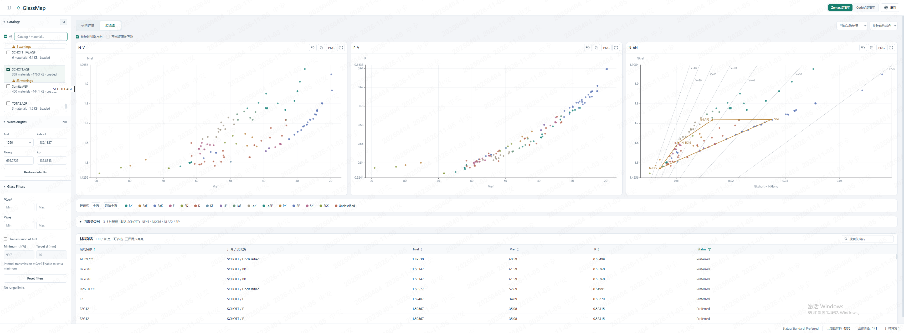

# GlassMap

面向光学设计工程师的本地玻璃库浏览与可视化工具。使用一个 HTML 文件，读取 Zemax 和 CODE V 材料库，通过图谱、参数筛选和约束多边形辅助选材。

[微信公众号图文介绍](https://mp.weixin.qq.com/s/h_l8EiGnZRx4a-8mpNEPkQ)
<!-- 公众号文章发布后，将上方链接替换为正式文章链接即可。 -->

## 功能特点

- **本地读取**：支持 Zemax 文本 AGF 和 CODE V XML 玻璃库，两种来源独立切换；材料文件在浏览器中读取与计算，无需上传服务器，不改写源文件。
- **玻璃库管理**：勾选即加载，支持按库名或材料名查找玻璃库，可分别设置两种来源的默认目录。
- **三图联动**：N–V、P–V、N–ΔN 并排显示，共享图例，支持按厂商或玻璃族着色，以及材料选中高亮。
- **约束多边形**：在 N–ΔN 图上以 3～5 种玻璃构建凸多边形，配合 V=20～80、间隔10的等值线查看约束区域。
- **组合筛选**：按名称、Nλref、Vλref、材料 Status 和内部透过率筛选；Status 默认选择 Standard、Preferred，从列表表头调整。
- **透过率换算**：指定参考波长和目标厚度，对不同厚度的有效记录进行换算，并支持波长插值。
- **材料详情**：查看基本参数、色散系数、透过率表格与曲线、热学及机械属性、原始记录和解析警告。
- **图表与列表**：支持滚轮缩放、拖动平移、复原、指针坐标、复制图片、PNG 下载、全屏，以及材料参数排序和虚拟滚动。

玻璃族当前按 SCHOTT、CDGM 的命名规则识别，无法确定的材料保留为 `Unclassified`。

## 快速使用

1. 下载 `GlassMap.html`，使用桌面版 **Microsoft Edge 或 Google Chrome** 打开。
2. 点击 **Zemax玻璃库** 或 **CodeV玻璃库**，选择本机对应目录。
3. 勾选需要的玻璃库，等待材料加载。
4. 设置 λref、λshort、λlong、λp，并按条件筛选材料。
5. 在 **材料详情** 与 **玻璃图** 之间切换，查看和比较候选材料。

使用交付文件无需安装应用、配置开发环境或搭建后端服务器。默认目录恢复取决于浏览器是否保留目录授权；仅填写路径不能代替授权。

## 三幅玻璃图

| 图谱 | 横坐标           | 纵坐标 | 用途                       |
| ---- | ---------------- | ------ | -------------------------- |
| N–V  | Vλref            | Nλref  | 比较折射率与色散分布       |
| P–V  | Vλref            | P      | 比较相对部分色散           |
| N–ΔN | Nλshort − Nλlong | Nλref  | 查看材料区域与玻璃约束边界 |

N–V、P–V 的横轴范围覆盖全部绘图材料，刻度文字仅标注 **20、30……90**。

约束多边形默认采用 SCHOTT 的 **NFK5、NSK16、NLAF2、SF4**，支持带连字符的名称变体。节点从已加载材料中查找，不受列表筛选影响；节点缺失、重名或无法构成凸多边形时会提示。此功能用于可视化查看，不会向 CODE V 写入约束或执行系统优化。

## 计算定义

界面波长单位为 **nm**。当前波长设置下：

$$N_{\mathrm{ref}}=n(\lambda_{\mathrm{ref}}),\qquad \Delta N=n(\lambda_{\mathrm{short}})-n(\lambda_{\mathrm{long}})$$

$$
V_{\mathrm{ref}}=\frac{N_{\mathrm{ref}}-1}{\Delta N},\qquad
P=\frac{n(\lambda_p)-n(\lambda_{\mathrm{short}})}{\Delta N}
$$

内部透过率按厚度换算：

$$
\tau(d_{\mathrm{target}})=\tau(d_{\mathrm{sample}})^{d_{\mathrm{target}}/d_{\mathrm{sample}}}
$$

内部透过率不含表面反射损失；波长插值不进行外推。换算结果用于候选筛选，最终选材应结合厂商数据与系统要求复核。

## 当前支持范围

| 来源       | 已实现的色散计算                                             |
| ---------- | ------------------------------------------------------------ |
| Zemax AGF  | Sellmeier 1，公式编号 **2**                                  |
| CODE V XML | Laurent、Glass Manufacturer Laurent、Glass Manufacturer Sellmeier、Standard Sellmeier、Glass Manufacturer Cauchy |

- **解析与计算独立**：可读取的材料不一定能计算。未实现的公式（包括 CODE V Herzberger）保留原始记录并标注暂不支持；设置备注中的公式列表不代表全部已实现。
- **缺失或越界数据**：系数缺失、有效波长范围异常、波长越界或色散分母趋近零，可能使部分计算不可用；仍有效的计算量可用于对应图谱。
- **状态编码独立**：Zemax Status 与 CODE V Availability 分别解释；材料状态不等于计算有效性。
- **格式限制**：不支持非文本 TSD 容器、Zemax BGF 或 CODE V 辅助 CAT 文件；CODE V Internal Absorbance 不作为内部透过率使用。
- **浏览器能力**：目录恢复与图片复制依赖浏览器和授权；无法复制图片时可使用 PNG 下载。

## 文件说明

- `GlassMap.html`：单文件应用，已内嵌运行资源与依赖。
- `README.zh-CN.md`：中文项目介绍。
- `images/glassmap-overview.png`：项目界面截图。

应用使用 HTML、CSS、JavaScript、浏览器 Worker 和 Apache ECharts。设置与目录句柄保存在本机浏览器中。交付 HTML 中已包含所打包第三方组件的许可证声明，重新分发时应保留。

项目不附带厂商玻璃库，请自行提供材料文件并遵循其适用条款。
